# Wireshark Packet Capture Casebook

**Type:** Cross-cutting evidence artifact — not a Cherwood division, no subdomain
**References:** Cherwood Health (SSL-VPN, DMZ segmentation), HA/Failover Lab (HSRP), Cherwood Network Solutions (LLDP / Topology Discovery)
**Status:** Complete — 4 of 4 required entries, each with a real `.pcap`/`.pcapng` file and screenshots

---

## Why this exists

Everything else in this portfolio is provable through configs, dashboards, and screenshots of GUIs. None of it proves I can actually read a packet — and "walk me through a capture" is one of the most common practical tests in a network engineer or analyst interview. This is a small, deliberately-scoped casebook: four real captures, each tied to a specific moment from projects I'd already built, with the real troubleshooting story behind each one, including the mistakes and how they were diagnosed.

No new infrastructure was stood up to generate any of this traffic — every entry piggybacks on systems already live in the portfolio.

---

## Entry 1 — SSL-VPN TLS Handshake & Cipher Negotiation

**File:** [`captures/ssl-vpn-handshake.pcap`](captures/ssl-vpn-handshake.pcap)
**Source:** FortiGate 60E, `diagnose sniffer packet wan1 'port 10443' 6 200`
**Ties to:** Cherwood Health's documented `banned-cipher` SSL-VPN bug

### Context

Cherwood Health's SSL-VPN config explicitly restricts negotiated ciphers:
```
set banned-cipher SHA1
set ciphersuite TLS-AES-128-GCM-SHA256 TLS-AES-256-GCM-SHA384 TLS-CHACHA20-POLY1305-SHA256
```
This entry captures the real handshake that results from that config on the wire — not a description of it.

### What's in the capture

Two separate TLS 1.3 sessions against the FortiGate's SSL-VPN portal (`192.168.1.177:10443`):

1. **My own device** (`192.168.1.160`) — a clean ClientHello → ServerHello → encrypted application data exchange. The ClientHello's offered cipher list includes `1301 / 1302 / 1303` (TLS 1.3's `TLS_AES_128_GCM_SHA256` / `TLS_AES_256_GCM_SHA384` / `TLS_CHACHA20_POLY1305_SHA256`) — exactly the three ciphers the FortiGate's `ciphersuite` line allows, confirmed against the live config, not assumed.
2. **An unsolicited external IP** (`87.58.199.137`) — a second, independent full TLS 1.3 handshake, sourced from the open internet.


*Working through portal reachability before capturing — SSL-VPN is bound to `wan1` only (`source-interface "wan1"`), so testing had to originate from a device on the same subnet as the WAN interface.*

### The finding that wasn't part of the plan

Capture #2 shouldn't have been possible if this lab were purely internal — and it wasn't a mistake. Tracing it (FortiGate `firewall vip` → empty, `firewall policy` → no inbound WAN rule → home router's own Port Forwarding page) turned up a rule I'd set up myself: `SSL-VPN, 10443/TCP → 192.168.1.177:10443, Always`. The lab's SSL-VPN portal is genuinely internet-facing, on purpose, so I can reach it remotely — and this capture caught a real scanner probing it, within the normal window any exposed VPN endpoint gets found in. Confirmed intentional, left in place; `login-attempt-limit 2` / `login-block-time 60` are the actual defense against traffic like this, not obscurity.

### What it proves

- Real understanding of TLS 1.3 handshake structure (ClientHello/ServerHello/cipher suite bytes), not just the concept
- The FortiGate's cipher-hardening config is provably in effect on the wire, not just present in `show`
- Comfort tracing an unexpected finding through firewall policy, VIPs, and router NAT instead of ignoring it

---

## Entry 2 — HSRP Hello Traffic & Failover Cutover

**Files:** [`captures/hsrp-failover-cutover.pcapng`](captures/hsrp-failover-cutover.pcapng), [`captures/hsrp-rejoin-recovery.pcapng`](captures/hsrp-rejoin-recovery.pcapng)
**Source:** Laptop on Financial-SW2 Gi0/3 (SPAN destination), Wireshark
**Ties to:** HA/Failover Lab

### Context

The original HA/Failover test measured cutover with a stopwatch (~2s, via continuous `ping -t` to the VIP). This entry replaces that estimate with a real, packet-timestamped measurement.

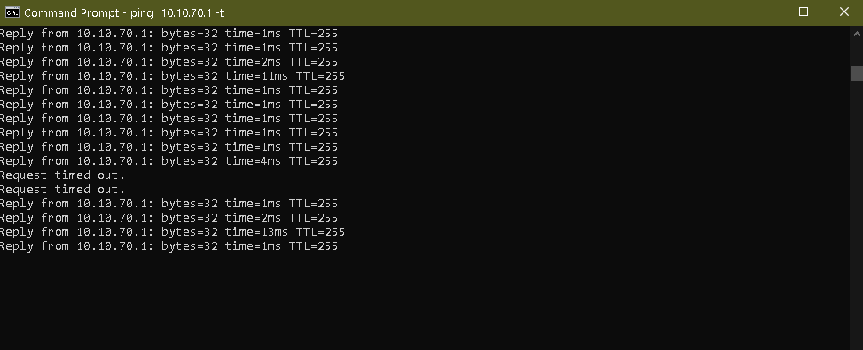
*The original HA/Failover evidence: continuous ping to the VIP (`10.10.70.1`) showing two dropped requests during the original cutover test — the baseline this capture improves on.*

### Baseline — before triggering anything

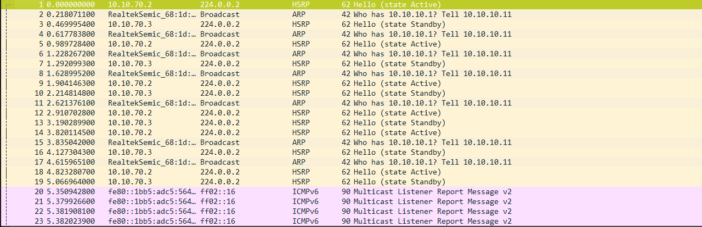
*Steady-state capture confirming both switches agree on roles before touching any cable: `10.10.70.2` sending Hello (state Active), `10.10.70.3` sending Hello (state Standby), alternating on schedule.*

| | |
|---|---|
| 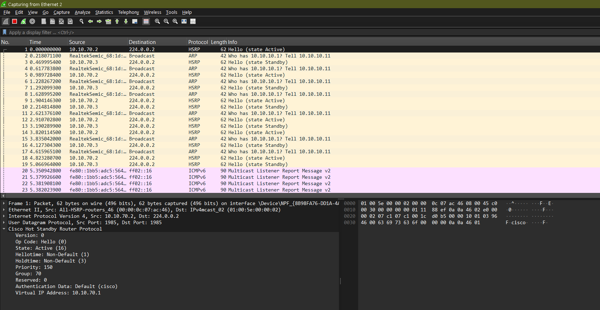 | 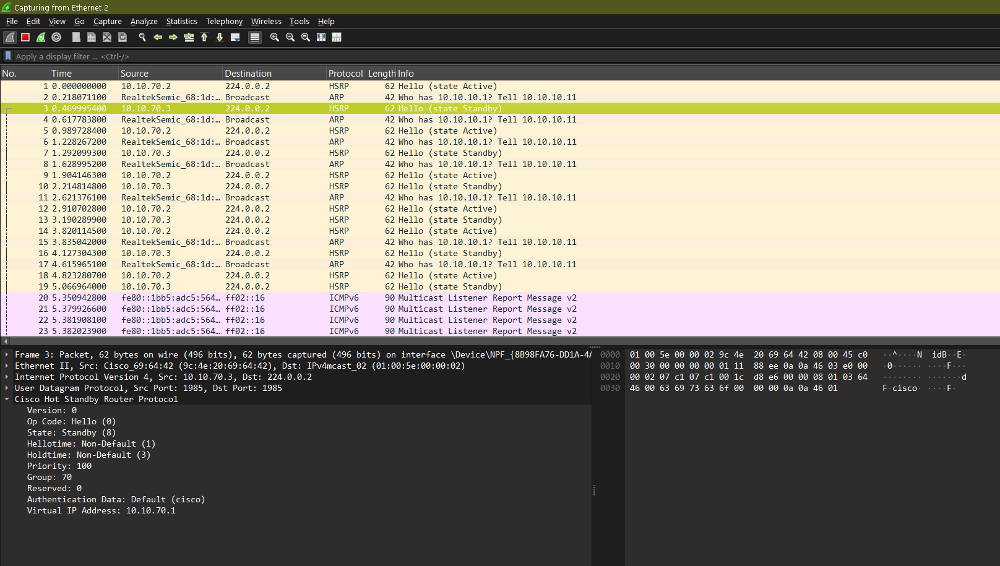 |
| Primary's Hello: `State: Active (16)`, Priority 150 | Financial-SW2's Hello: `State: Standby (8)`, Priority 100 |

### What went wrong first — and why it was worth keeping

**Attempt 1:** Laptop plugged into the switch that then got powered off — the capture died at the exact moment it mattered. Lesson: the capture point has to survive the event being captured.

**Attempt 2 (after moving to the surviving switch):**

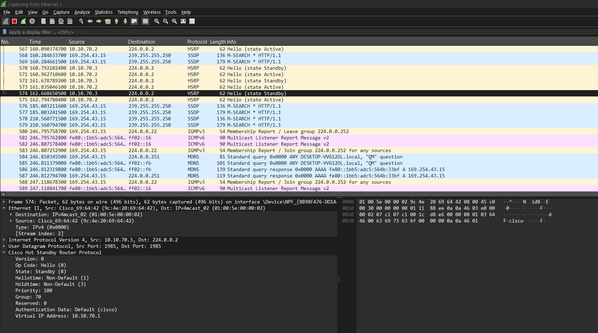
*A red herring at first glance — repeated DHCP Discover packets with no replies. Traced to the fact that a SPAN destination port is receive-only; the laptop's routine DHCP renewal request went out and got no answer. Unrelated to the switches, expected SPAN behavior.*

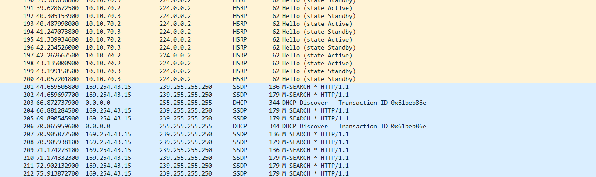
*The real finding from this attempt: total HSRP silence for the entire outage window — not a capture bug. Financial-SW2's only VLAN 70 member port was the trunk to the primary; when that link died, the VLAN 70 SVI went down with it, and HSRP cannot transmit in any state while its interface is down.*

**Fix:** added a second, independent VLAN 70 member port (a spare switch on Gi0/2) so Financial-SW2's SVI would survive the primary going down.

### The real transition, captured cleanly


*Packets 856–859: `10.10.70.3` sends Advertise (state Active) → Hello (state Active) → Gratuitous ARP for the VIP, `10.10.70.1`, announcing the new mapping to the LAN.*

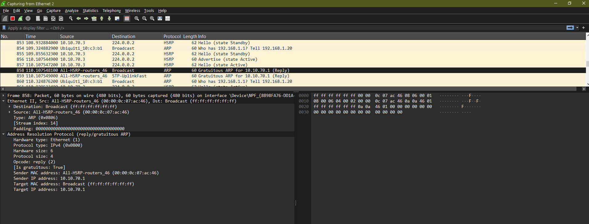
*The Gratuitous ARP detail: sender `All-HSRP-routers_46`, claiming `10.10.70.1` — the mechanism that makes failover transparent to every other device on the segment without waiting on ARP cache timeouts.*

**Measured from the raw pcap timestamps:**

| Event | Time |
|---|---|
| Primary's last Hello, state Active | `t = 106.78s` |
| Financial-SW2 sends Advertise | `t = 110.11s` |
| Financial-SW2's first Hello, state Active | `t = 110.11s` |

**Failover time: 3.33 seconds** — matches the configured 3-second holdtime almost exactly. A real number from packet timestamps, not a stopwatch estimate.

### Rejoin — confirming the no-preempt design holds

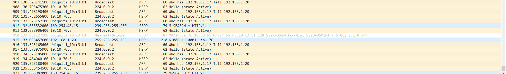
*After the primary reboots and rejoins, `10.10.70.3` continues sending Hello (state Active) — it does not step down. Confirms `no preempt` is actually enforced on the wire, not just present in the config.*

| Event | Time (file-relative) |
|---|---|
| Primary sends first Advertise after reboot | `t = 256.48s` |
| Primary reaches state Speak | `t = 259.86s` |
| Primary settles into state **Standby** | `t = 262.86s` |

### What it proves

- Real HSRP state machine understanding (Hello vs. Advertise, Active/Standby/Speak/Listen)
- SPAN configuration and placement — specifically, that capture-point survivability relative to the failure under test matters
- Root-cause reasoning about SVI/VLAN membership dependencies instead of assuming the tooling was broken

---

## Entry 3 — LLDP Discovery Frames

**File:** [`captures/lldp-discovery-cisco.pcapng`](captures/lldp-discovery-cisco.pcapng)
**Source:** SPAN on Cherwood-3560E Gi0/3 → Gi0/8, plus native FortiGate sniffer
**Ties to:** Cherwood Network Solutions — Automated Topology Discovery (`topology.py`)

### Context

`topology.py` builds a live network diagram from LLDP data pulled over SSH. This entry captures the same protocol at the packet level — the raw TLVs the script's parser actually consumes.

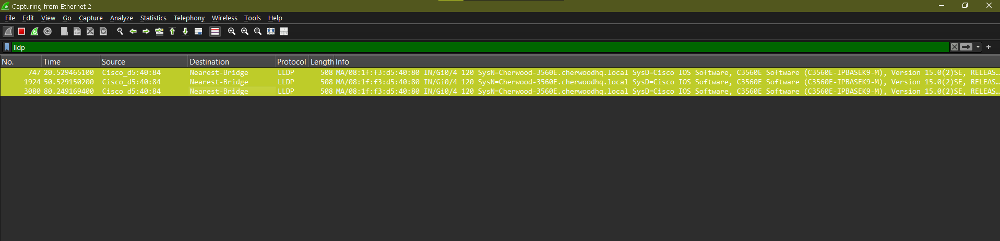
*The Cisco 3560E's own LLDP announcements, filtered on `lldp`, arriving every ~30 seconds — matches the standard LLDP transmit interval exactly.*


*Full TLV structure: Chassis Subtype (MAC address), Port Subtype (interface name), TTL 120s, System Name/Description, Capabilities, Management Address — the exact fields `parse_cisco_detail()` extracts in `topology.py`.*

### The finding that mattered more than the clean capture

The FortiGate's own LLDP frame never showed up in this same SPAN capture, despite `lldp-reception`/`lldp-transmission` both confirmed enabled. Rather than assume it was broken, I verified at the source:

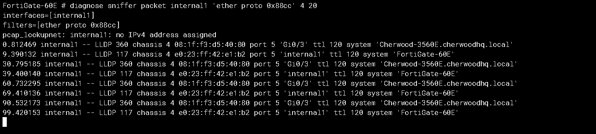
*`diagnose sniffer packet internal1 'ether proto 0x88cc'` on the FortiGate itself — confirms it's reliably transmitting LLDP every ~30s, four clean cycles. The frame exists and leaves the interface.*

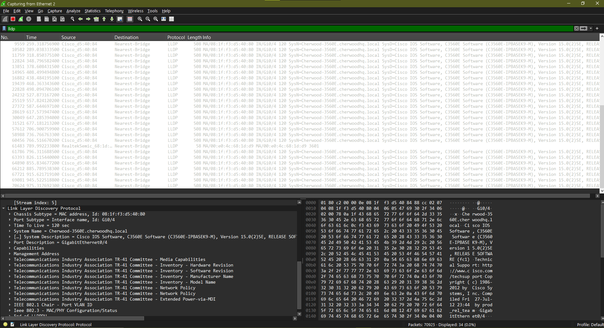
*16+ minutes, 34 Cisco LLDP frames captured, zero from the FortiGate — confirms this is a consistent, structural gap, not a one-off miss.*

The most likely explanation: LLDP's destination MAC (`01:80:C2:00:00:0E`) is shared with STP BPDUs, and the switch's control plane consumes it rather than simply flooding it through SPAN. This is the same cross-vendor gap `topology.py` had to design around at the command level (its own Bug #1) — this capture makes the same gap visible at the packet level.

### What it proves

- Real LLDP TLV structure knowledge, matched directly against what `topology.py`'s parser extracts
- A sourced, verified explanation for a capture gap rather than an assumption
- Two independent capture methods (SPAN/Wireshark vs. native device sniffer) used to triangulate the same fact

---

## Entry 4 — Blocked DMZ → Trusted Reconnaissance Attempt

**File:** [`captures/dmz-recon-blocked.pcap`](captures/dmz-recon-blocked.pcap)
**Source:** FortiGate 60E, `diagnose sniffer packet any 'host 10.10.40.2 and host 10.10.10.1' 6 20`
**Ties to:** Cherwood Health — segmentation testing

### Context

Cherwood Health's segmentation design blocks DMZ (VLAN 40) from reaching Trusted (VLAN 10). This was originally proven via the FortiGate's traffic logs; this entry re-proves it at the packet level, re-run fresh for this casebook and reproducing the exact same result as the original finding.


*Four ICMP echo-requests, `10.10.40.2 → 10.10.10.1`, arriving at the FortiGate. Zero echo-replies, anywhere.*

### Why "no reply" is the actual finding

This traffic never appears in the FortiGate's Forward Traffic, Local Traffic, or Security Event logs — traffic addressed to the firewall's own interface IP that gets denied falls into a narrower local-in-deny category FortiGate doesn't log by default, separate from normal Forward Traffic logging. A packet capture proves the block regardless of what the log viewer shows — more rigorous evidence than "the log says so."

### What it proves

- Segmentation enforcement confirmed at the packet level, independent of (and more reliable than) the GUI log viewer
- Understanding of the distinction between traffic-to-self-interface handling and normal forwarded-traffic logging on FortiGate
- A negative result (no reply) documented as real evidence, not treated as "nothing happened"

---

## What was explicitly skipped

- **RIP updates (HQ↔Branch):** optional per scope, skipped since the four required entries were sufficient
- **A full protocol-analysis tutorial:** this is evidence of capability, not a teaching series
- **New infrastructure to generate traffic:** every capture piggybacked on systems and traffic already in motion from other projects

## Where it lives

A small standalone repo — cross-cutting evidence referencing three other projects, not a new Cherwood division, so it doesn't get its own subdomain or a place in the division structure.

## Resume / LinkedIn framing

> Captured and analyzed live traffic across VPN, HSRP failover, LLDP discovery, and firewall segmentation events using Wireshark and native device packet capture tools, published as an annotated packet-capture casebook tied to real troubleshooting and validation work across the Cherwood Corporation portfolio.
