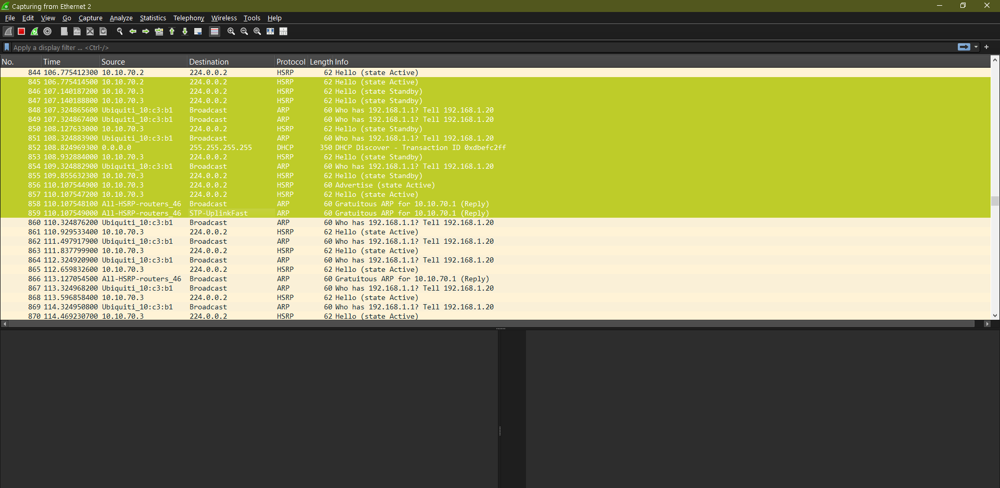
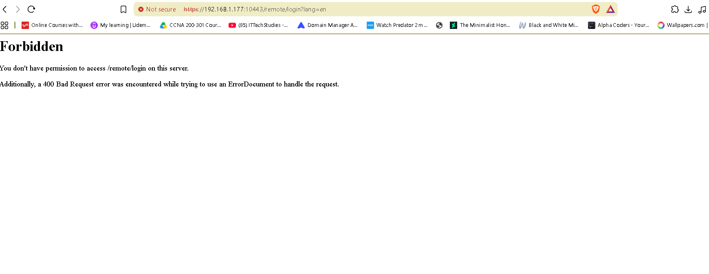
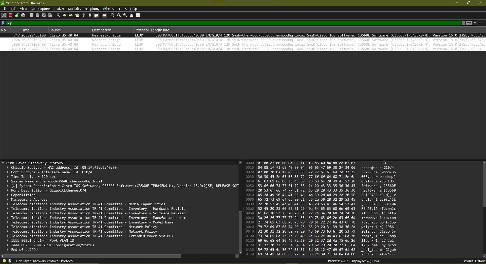
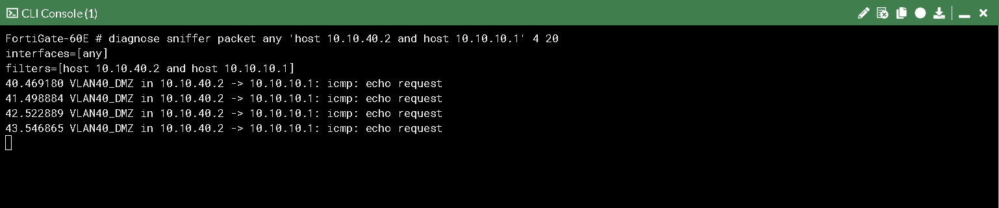

# Packet Capture Casebook

Four real packet captures, each tied to a specific bug or design decision from my other [home lab projects](https://taruncherukurigit.github.io/portfolio-page/) — not a tutorial series, evidence that I can actually read what's on the wire.

## Entries

| # | Capture | What it proves |
|---|---|---|
| 1 | [SSL-VPN TLS handshake](PACKET-CAPTURES.md#entry-1--ssl-vpn-tls-handshake--cipher-negotiation) | Cipher-hardening config confirmed live on the wire, plus a real internet scanner caught mid-handshake against the intentionally exposed portal |
| 2 | [HSRP failover cutover](PACKET-CAPTURES.md#entry-2--hsrp-hello-traffic--failover-cutover) | Measured failover time from real timestamps (3.33s) instead of a stopwatch estimate, plus the full troubleshooting trail (wrong capture point → SVI-down root cause → fix) |
| 3 | [LLDP discovery frames](PACKET-CAPTURES.md#entry-3--lldp-discovery-frames) | Raw TLVs matched against what `topology.py` actually parses, plus a verified explanation for why FortiGate's LLDP never crossed a SPAN capture |
| 4 | [Blocked DMZ→Trusted recon](PACKET-CAPTURES.md#entry-4--blocked-dmz--trusted-reconnaissance-attempt) | Segmentation enforcement proven at the packet level — request in, no reply, ever |

**Full writeup with timestamps, TLV breakdowns, and the real troubleshooting story behind each capture: [PACKET-CAPTURES.md](PACKET-CAPTURES.md)**

## At a glance

**HSRP failover — the actual cutover, captured:**

`10.10.70.3` sends Advertise → Hello (state Active) → Gratuitous ARP for the VIP. Measured failover: **3.33 seconds**, from raw packet timestamps.

**SSL-VPN — real TLS negotiation against the live portal:**

Full TLS 1.3 handshake captured on `wan1`, including one from an unsolicited internet scanner hitting the intentionally exposed portal.

**LLDP — the raw TLVs `topology.py` parses, matched frame-for-frame:**


**Blocked DMZ→Trusted recon — request in, zero replies:**


## Repo structure

```
PACKET-CAPTURES.md              full writeup, all screenshots embedded inline
captures/
  ssl-vpn-handshake.pcap        entry 1
  hsrp-failover-cutover.pcapng  entry 2 — the cutover itself
  hsrp-rejoin-recovery.pcapng   entry 2 — primary rejoining, no-preempt confirmed
  lldp-discovery-cisco.pcapng   entry 3
  dmz-recon-blocked.pcap        entry 4
screenshots/
  01-ssl-vpn/
  02-hsrp-failover/
  03-lldp/
  04-dmz-recon/
```

Open any `.pcap`/`.pcapng` in Wireshark.

## Related projects
- [Segmented Enterprise Network](https://github.com/taruncherukurigit/cherwood-health) — SSL-VPN, DMZ segmentation
- [HSRP High-Availability Lab](https://github.com/taruncherukurigit/hsrp-failover-lab) — HSRP
- [Python Network Automation](https://github.com/taruncherukurigit/network-automation-toolkit) — LLDP and topology discovery
